<picture>
  <source media="(prefers-color-scheme: dark)" srcset="assets/hello4-dark.svg"/>
  
</picture>

[LinkedIn](https://www.linkedin.com/in/saswati-panda/) &nbsp;·&nbsp; [Medium](https://medium.com/@saswatipanda91)

 

<picture><source media="(prefers-color-scheme: dark)" srcset="assets/h-pub-dark.svg"/></picture>

<a href="https://doi.org/10.21203/rs.3.rs-11294579/v1"><picture><source media="(prefers-color-scheme: dark)" srcset="assets/paper-n1-dark.svg"/></picture></a>

<a href="https://doi.org/10.1186/s13321-026-01207-4"><picture><source media="(prefers-color-scheme: dark)" srcset="assets/paper-n2-dark.svg"/></picture></a>

<a href="https://doi.org/10.1038/s44321-026-00415-7"><picture><source media="(prefers-color-scheme: dark)" srcset="assets/paper-n3-dark.svg"/></picture></a>

<a href="https://pmc.ncbi.nlm.nih.gov/articles/PMC10353056/"><picture><source media="(prefers-color-scheme: dark)" srcset="assets/paper-n4-dark.svg"/></picture></a>

<picture><source media="(prefers-color-scheme: dark)" srcset="assets/press-dark.svg"/></picture>
<a href="https://phys.org/news/2026-07-tuberculosis-drug-discovery-smarter-ai.html">Phys.org</a> &nbsp;·&nbsp; <a href="https://www.drugtargetreview.com/researchers-develop-ai-system-to-accelerate-tuberculosis-drug-discovery/2136121.article">Drug Target Review</a> &nbsp;·&nbsp; <a href="https://www.the-microbiologist.com/news/tuberculosis-drug-discovery-gets-smarter-with-ai/9645.article">The Microbiologist</a> &nbsp;·&nbsp; <a href="https://www.news-medical.net/news/20260730/Texas-AM-researchers-build-AI-tools-for-tuberculosis-drug-discovery.aspx">News-Medical</a>

 
 

<picture><source media="(prefers-color-scheme: dark)" srcset="assets/h-products-dark.svg"/></picture>

Used by drug discovery teams in academic, nonprofit, and pharmaceutical organizations.

<a href="https://docustore.io/"><picture><source media="(prefers-color-scheme: dark)" srcset="assets/about-docustore-dark.svg"/></picture></a>
<b>DocuStore</b> 
<a href="https://docustore.io/">docustore.io</a> <a href="https://doi.org/10.21203/rs.3.rs-11294579/v1">Publication</a>

<picture><source media="(prefers-color-scheme: dark)" srcset="assets/rule-dark.svg"/></picture>

<a href="https://www.chemcellar.com/"><picture><source media="(prefers-color-scheme: dark)" srcset="assets/about-chemcellar-dark.svg"/></picture></a>
<b>ChemCellar</b> 
<a href="https://www.chemcellar.com/">chemcellar.com</a>

<picture><source media="(prefers-color-scheme: dark)" srcset="assets/rule-dark.svg"/></picture>

<a href="https://parsnip-56158.web.app/"><picture><source media="(prefers-color-scheme: dark)" srcset="assets/about-parsnip-dark.svg"/></picture></a>
<b>PARSNIP</b> 
<a href="https://parsnip-56158.web.app/">Live app</a> <a href="https://doi.org/10.1038/s44321-026-00415-7">Publication</a>

<picture><source media="(prefers-color-scheme: dark)" srcset="assets/rule-dark.svg"/></picture>

<a href="https://studio.orca-03.biobio.tamu.edu/login"><picture><source media="(prefers-color-scheme: dark)" srcset="assets/about-cage-fusion-dark.svg"/></picture></a>
<b>CAGE-Fusion</b> 
<a href="https://studio.orca-03.biobio.tamu.edu/login">Live app</a> <a href="https://doi.org/10.1186/s13321-026-01207-4">Publication</a> <a href="https://doi.org/10.5281/zenodo.17118024">Dataset</a>

<picture><source media="(prefers-color-scheme: dark)" srcset="assets/rule-dark.svg"/></picture>

<a href="https://saclab.github.io/daikon/"><picture><source media="(prefers-color-scheme: dark)" srcset="assets/about-daikon-dark.svg"/></picture></a>
<b>DAIKON</b> 
<a href="https://saclab.github.io/daikon/">saclab.github.io/daikon</a> <a href="https://pmc.ncbi.nlm.nih.gov/articles/PMC10353056/">Publication</a> <a href="https://www.tbdrugaccelerator.org">TB Drug Accelerator</a>

<picture><source media="(prefers-color-scheme: dark)" srcset="assets/rule-dark.svg"/></picture>

<picture><source media="(prefers-color-scheme: dark)" srcset="assets/about-daikon-ai-dark.svg"/></picture>
<b>DAIKON AI &amp; Curator Studio</b> 
Coming soon

<picture><source media="(prefers-color-scheme: dark)" srcset="assets/rule-dark.svg"/></picture>

### Toolkit

<picture>
  <source media="(prefers-color-scheme: dark)" srcset="assets/toolkit-wc-dark.svg"/>
  
</picture>

 

  Building something in AI, health, or science? <a href="https://www.linkedin.com/in/saswati-panda/"><b>Let's talk →</b></a>

