<picture>
  <source media="(prefers-color-scheme: dark)" srcset="assets/hi-dark.svg"/>
  
</picture>

[LinkedIn](https://www.linkedin.com/in/saswati-panda/) &nbsp;·&nbsp; [Medium](https://medium.com/@saswatipanda91)

I turn research pain points into AI products scientists rely on by framing the problem, aligning stakeholders, and shipping drug discovery tools powered by LLMs and graph neural networks.

 

### Published

**[1]** &nbsp;[DocuStore: Domain-constrained retrieval-augmented generation for drug discovery documents](https://doi.org/10.21203/rs.3.rs-11294579/v1) 
&nbsp;&nbsp;&nbsp;&nbsp;&nbsp;&nbsp;Preprint · 2026

**[2]** &nbsp;[CAGE-Fusion: Deep learning for assay nuisance compound detection using a gated co-attention graph embedding model](https://doi.org/10.1186/s13321-026-01207-4) 
&nbsp;&nbsp;&nbsp;&nbsp;&nbsp;&nbsp;*Journal of Cheminformatics* · Springer Nature · 2026

**[3]** &nbsp;[Integrating chemical, genetic, and feasibility assessments for anti-tubercular target validation](https://doi.org/10.1038/s44321-026-00415-7) 
&nbsp;&nbsp;&nbsp;&nbsp;&nbsp;&nbsp;*EMBO Molecular Medicine* · Springer Nature · 2025

**[4]** &nbsp;[DAIKON: A data acquisition, integration, and knowledge capture web application for target-based drug discovery](https://pmc.ncbi.nlm.nih.gov/articles/PMC10353056/) 
&nbsp;&nbsp;&nbsp;&nbsp;&nbsp;&nbsp;*ACS Pharmacology & Translational Science* · 2023

> **Recent work covered in the media** &nbsp;
> [Phys.org](https://phys.org/news/2026-07-tuberculosis-drug-discovery-smarter-ai.html) &nbsp;·&nbsp; [Drug Target Review](https://www.drugtargetreview.com/researchers-develop-ai-system-to-accelerate-tuberculosis-drug-discovery/2136121.article) &nbsp;·&nbsp; [The Microbiologist](https://www.the-microbiologist.com/news/tuberculosis-drug-discovery-gets-smarter-with-ai/9645.article) &nbsp;·&nbsp; [News-Medical](https://www.news-medical.net/news/20260730/Texas-AM-researchers-build-AI-tools-for-tuberculosis-drug-discovery.aspx)

 

### Products I've helped ship

<picture>
  <source media="(prefers-color-scheme: dark)" srcset="assets/products-dark.svg"/>
  
</picture>

Used by drug discovery teams in academic, nonprofit, and pharmaceutical organizations. Open one for links and my role.

&nbsp; <b>DocuStore</b> &nbsp;my role and links

<blockquote>
<b>My role</b> &nbsp;Co-first author. Built the multi-agent AI knowledge base that auto-sorted 1,500+ documents and cut manual curation time by 70%. 
<a href="https://docustore.io/">docustore.io</a> &nbsp;·&nbsp; <a href="https://doi.org/10.21203/rs.3.rs-11294579/v1">Publication</a>
</blockquote>

&nbsp; <b>ChemCellar</b> &nbsp;links

<blockquote>
<a href="https://www.chemcellar.com/">chemcellar.com</a>
</blockquote>

&nbsp; <b>PARSNIP</b> &nbsp;links

<blockquote>
<a href="https://parsnip-56158.web.app/">Live app</a> &nbsp;·&nbsp; <a href="https://doi.org/10.1038/s44321-026-00415-7">Publication</a>
</blockquote>

&nbsp; <b>CAGE-Fusion</b> &nbsp;my role and links

<blockquote>
<b>My role</b> &nbsp;Co-first author. Built the detection framework, which improved detection accuracy by 4%. 
<a href="https://studio.orca-03.biobio.tamu.edu/login">Live app</a> &nbsp;·&nbsp; <a href="https://doi.org/10.1186/s13321-026-01207-4">Publication</a> &nbsp;·&nbsp; <a href="https://github.com/sidxz/cage_fusion">GitHub</a> &nbsp;·&nbsp; <a href="https://doi.org/10.5281/zenodo.17118024">Dataset</a>
</blockquote>

<picture><source media="(prefers-color-scheme: dark)" srcset="assets/apps/daikon-dark.png"/></picture>&nbsp; <b>DAIKON</b> &nbsp;my role and links

<blockquote>
<b>My role</b> &nbsp;Led front-end design and development, and ran usability studies with 20+ stakeholders. 
<a href="https://saclab.github.io/daikon/">saclab.github.io/daikon</a> &nbsp;·&nbsp; <a href="https://pmc.ncbi.nlm.nih.gov/articles/PMC10353056/">Publication</a>
</blockquote>

&nbsp; <b>DAIKON AI &amp; Curator Studio</b> &nbsp;my role and links

<blockquote>
<b>My role</b> &nbsp;Product and front-end.
</blockquote>

 

### Toolkit

**Product** &nbsp; User Research · Roadmapping · KPI Design · Agile / Scrum · Figma · Confluence · Tableau 
**AI / Data** &nbsp; Python · LangChain · Hugging Face · scikit-learn · SQL · KNIME 
**Build** &nbsp; React · Next.js · Azure · Docker

 

  Building something in AI, health, or science? <a href="https://www.linkedin.com/in/saswati-panda/"><b>Let's talk →</b></a>

