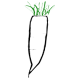

  

  
  

---

### Publications

| Year | Paper | Venue |
|:-:|:--|:--|
| 2026 | [**DocuStore:** Domain-constrained retrieval-augmented generation for drug discovery documents](https://doi.org/10.21203/rs.3.rs-11294579/v1) | Preprint |
| 2026 | [**CAGE-Fusion:** Deep learning for assay nuisance compound detection using a gated co-attention graph embedding model](https://doi.org/10.1186/s13321-026-01207-4) | *Journal of Cheminformatics* · Springer Nature |
| 2025 | [Integrating chemical, genetic, and feasibility assessments for anti-tubercular target validation](https://doi.org/10.1038/s44321-026-00415-7) | *EMBO Molecular Medicine* · Springer Nature |
| 2023 | [**DAIKON:** A data acquisition, integration, and knowledge capture web application for target-based drug discovery](https://pmc.ncbi.nlm.nih.gov/articles/PMC10353056/) | *ACS Pharmacology & Translational Science* |

> ### Recent work covered in the media
> [Phys.org](https://phys.org/news/2026-07-tuberculosis-drug-discovery-smarter-ai.html) &nbsp;·&nbsp; [Drug Target Review](https://www.drugtargetreview.com/researchers-develop-ai-system-to-accelerate-tuberculosis-drug-discovery/2136121.article) &nbsp;·&nbsp; [The Microbiologist](https://www.the-microbiologist.com/news/tuberculosis-drug-discovery-gets-smarter-with-ai/9645.article) &nbsp;·&nbsp; [News-Medical](https://www.news-medical.net/news/20260730/Texas-AM-researchers-build-AI-tools-for-tuberculosis-drug-discovery.aspx)

---

### Products I've helped ship

Applications I've helped take from idea to production and now used by drug discovery teams in academic, nonprofit, and pharmaceutical organizations.

<table>
  <tr>
    <td width="68" align="center" valign="middle"></td>
    <td valign="top">
      <b>DocuStore</b> &nbsp;·&nbsp; <a href="https://docustore.io/">docustore.io</a> · <a href="https://doi.org/10.21203/rs.3.rs-11294579/v1">Publication</a> 
      A chemistry-aware document intelligence platform for drug discovery. Scientists ask questions across a lab's papers and slide decks and get answers cited to the source. 
      <i>My role:</i> Co-first author. Built the multi-agent AI knowledge base that auto-sorted 1,500+ documents and cut manual curation time by 70%.
    </td>
  </tr>
  <tr>
    <td width="68" align="center" valign="middle"></td>
    <td valign="top">
      <b>ChemCellar</b> &nbsp;·&nbsp; <a href="https://www.chemcellar.com/">chemcellar.com</a> 
      An open-source platform for compound registration, management, and screening. Research groups register molecules, run screening campaigns, and decide what to make next, on infrastructure they control.
    </td>
  </tr>
  <tr>
    <td width="68" align="center" valign="middle"></td>
    <td valign="top">
      <b>PARSNIP</b> &nbsp;·&nbsp; <a href="https://parsnip-56158.web.app/">Live app</a> · <a href="https://doi.org/10.1038/s44321-026-00415-7">Publication</a> 
      A tuberculosis protein assessment and ranking system. It brings together genetic, chemical, and feasibility evidence so teams can rank drug targets the same way every time.
    </td>
  </tr>
  <tr>
    <td width="68" align="center" valign="middle"></td>
    <td valign="top">
      <b>CAGE-Fusion</b> &nbsp;·&nbsp; <a href="https://studio.orca-03.biobio.tamu.edu/login">Live app</a> · <a href="https://doi.org/10.1186/s13321-026-01207-4">Publication</a> · <a href="https://github.com/sidxz/cage_fusion">GitHub</a> · <a href="https://doi.org/10.5281/zenodo.17118024">Dataset</a> 
      A deep learning model that flags nuisance compounds, the false hits that waste early-stage assay work. It predicts aggregation, luciferase inhibition, chemical reactivity, and promiscuity. 
      <i>My role:</i> Co-first author. Built the detection framework, which improved detection accuracy by 4%.
    </td>
  </tr>
  <tr>
    <td width="68" align="center" valign="middle"><a href="https://saclab.github.io/daikon/"><picture>
      <source media="(prefers-color-scheme: dark)" srcset="assets/apps/daikon-dark.png"/>
      
    </picture></a></td>
    <td valign="top">
      <b>DAIKON</b> &nbsp;·&nbsp; <a href="https://saclab.github.io/daikon/">saclab.github.io/daikon</a> · <a href="https://pmc.ncbi.nlm.nih.gov/articles/PMC10353056/">Publication</a> 
      An open-source platform for collaborative, target-based drug discovery. It brings targets, screens, hits, compounds, and portfolios into one system. The <a href="https://www.tbdrugaccelerator.org">TB Drug Accelerator</a>, a Gates Foundation initiative with 25+ member organizations, has used it in production since 2022. 
      <i>My role:</i> Led front-end design and development, and ran usability studies with 20+ stakeholders.
    </td>
  </tr>
  <tr>
    <td width="68" align="center" valign="middle"></td>
    <td valign="top">
      <b>DAIKON AI &amp; Curator Studio</b> &nbsp;·&nbsp; <i>Closed user group testing · Coming soon</i> 
      The next generation of DAIKON. It covers data curation, AI/ML prediction, analysis, and project management across early discovery, from genes and targets through screening, hit assessment, and portfolio. 
      <i>My role:</i> Product and front-end.
    </td>
  </tr>
</table>

---

### Toolkit

**Product** &nbsp;

**AI / Data** &nbsp;

**Build** &nbsp;

---

  Building something in AI, health, or science and need a PM who can also read the code? <a href="https://www.linkedin.com/in/saswati-panda/"><b>Let's talk →</b></a>

